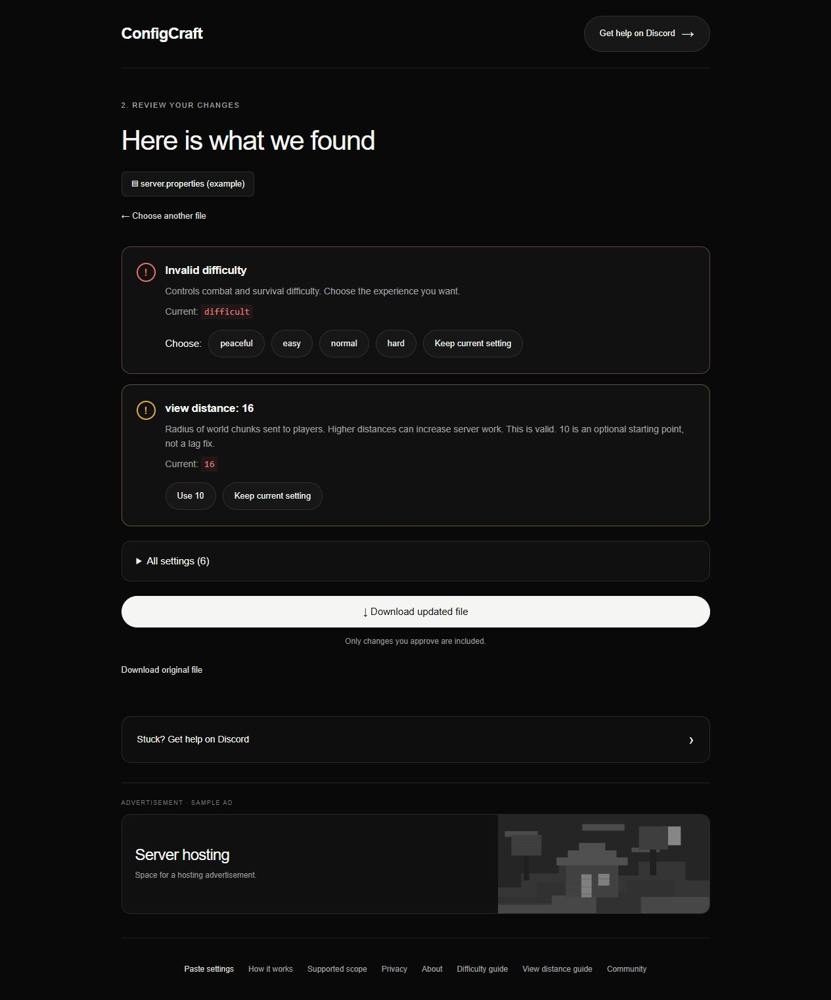

# ConfigCraft — Minecraft Java configuration checker

Review selected `server.properties` settings, understand findings, and download only the edits you approve.

**[Try ConfigCraft free →](https://configcraft.pages.dev/?utm_source=github&utm_medium=organic_social&utm_campaign=first_testers&utm_content=readme)** · [Try the example walkthrough](https://github.com/Deliross/configcraft-community/discussions/5) · [Ask a question](https://github.com/Deliross/configcraft-community/discussions)

No account needed. Choose **Try an example** to see the checker without opening your own server file.

## What it does

- Checks selected Minecraft Java `server.properties` values against version-specific rules.
- Explains invalid values and separates optional suggestions from errors.
- Offers Paper, Vanilla, Spigot, Purpur, Fabric, Forge and NeoForge profiles. Version availability varies by profile; use the versions shown in the checker.
- Preserves other values and applies only approved edits to the downloaded file.

For example, `difficulty=difficult` is invalid. You can approve `normal` while keeping a valid `view-distance=16`. The screenshot above shows the built-in example, not a customer configuration.

## Three steps

1. Select your server type and Minecraft version, then open `server.properties` or try the example.
2. Review each finding. Approve the edits you want; keep other settings.
3. Download your file. Back up the original and stop the server before replacing it. Start the server and check its logs afterward.

[How it works](https://configcraft.pages.dev/guides/how-it-works/) · [Find your file](https://configcraft.pages.dev/guides/find-file/) · [Replacement instructions](https://configcraft.pages.dev/guides/replace-file/)

## Privacy and limits

Configuration processing happens in your browser. ConfigCraft does not upload the file or connect to your server. The website uses Cloudflare Web Analytics for visit and performance measurement; that is separate from configuration processing. [Read the privacy explanation](https://configcraft.pages.dev/guides/privacy/).

This checks selected settings, not every possible server problem. It does not manage a running server, check plugin/mod configuration files, support Bedrock configuration, or guarantee a lag fix. Hosting panels may override settings. [Supported scope](https://configcraft.pages.dev/guides/scope/).

The screenshot contains a clearly labeled sample advertisement. It is a placeholder, not a claim that paid ads are active.

## Feedback and help

[Open a discussion](https://github.com/Deliross/configcraft-community/discussions) with the setting name, selected profile/version and what explanation was confusing. **Do not share passwords, tokens, private addresses or your whole configuration file.** A small invented example is enough.

[Discord help](https://discord.gg/xU7hqTXf)

## About this repository

This is the public community and documentation repository, not the checker's source-code repository. It does not provide an open-source license for the website implementation.

ConfigCraft was built with extensive OpenAI Codex assistance for implementation and content. The checker uses deterministic validation rules; it does not send your configuration to an LLM.
